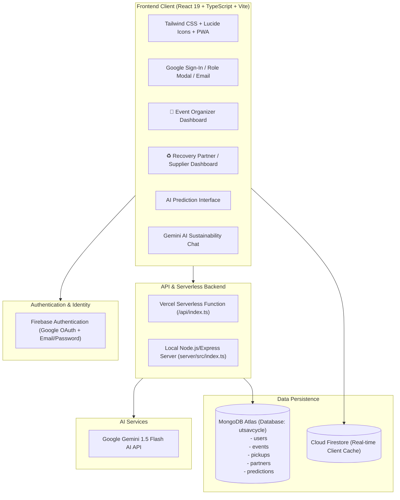

# UtsavCycle AI — Comprehensive Project Documentation

> **Turn Event & Festival Waste into Community Resources**  
> An AI-powered sustainability and circular economy platform connecting Indian event organizers with certified recovery partners and waste recyclers.

---

## 📌 Table of Contents

1. [Executive Summary](#1-executive-summary)
2. [Live Links & Repository](#2-live-links--repository)
3. [System Architecture](#3-system-architecture)
4. [User Roles & Access Control](#4-user-roles--access-control)
5. [Core Features & Modules](#5-core-features--modules)
   - [AI Waste Prediction Engine](#51-ai-waste-prediction-engine)
   - [Smart Recovery Partner Matching](#52-smart-recovery-partner-matching)
   - [Pickup Logistics & Tracking](#53-pickup-logistics--tracking)
   - [Environmental Impact Dashboard](#54-environmental-impact-dashboard)
   - [AI Sustainability Assistant](#55-ai-sustainability-assistant)
6. [Database Architecture (MongoDB Atlas & Firestore)](#6-database-architecture-mongodb-atlas--firestore)
   - [Data Models & Mongoose Schemas](#61-data-models--mongoose-schemas)
7. [REST API Reference](#7-rest-api-reference)
8. [Local Development Setup](#8-local-development-setup)
9. [MongoDB Compass Integration Guide](#9-mongodb-compass-integration-guide)
10. [Firebase Authentication & Configuration](#10-firebase-authentication--configuration)
11. [Deployment Architecture (Vercel Serverless)](#11-deployment-architecture-vercel-serverless)
12. [Security & Compliance](#12-security--compliance)

---

## 1. Executive Summary

Every year, millions of Indian weddings, festivals, pujas, and corporate events generate thousands of metric tons of surplus cooked food, floral decorations, plastics, paper, and fabrics. A vast majority of this waste ends up in municipal landfills, contributing to greenhouse gas emissions and resource depletion.

**UtsavCycle AI** solves this systemic issue by:
1. **Predicting waste before the event starts** using Google Gemini 1.5 Flash AI based on guest count, food style, duration, and decoration types.
2. **Matching organizers with verified local recovery partners** (food banks, floral composters, textile recyclers, and plastic processors) based on waste type, capacity, proximity, and availability.
3. **Coordinating and tracking pickups end-to-end** through real-time status transitions.
4. **Quantifying environmental impact** in CO₂ emissions saved, meals rescued, waste diverted, and trees equivalent.

---

## 2. Live Links & Repository

| Resource | Link / Information |
| :--- | :--- |
| 🌐 **Live Web Application** | [https://utsavai-beta.vercel.app](https://utsavai-beta.vercel.app) |
| 📦 **GitHub Repository** | [Deepika-bysani2006/UtsavCycle-AI-Festival-Wedding-Waste-Flow-Matcher](https://github.com/Deepika-bysani2006/UtsavCycle-AI-Festival-Wedding-Waste-Flow-Matcher) |
| 🍃 **MongoDB Atlas Database** | `utsavcycle` (Cluster0) |
| 🔥 **Firebase Project** | `utsavcycle-ai` |

---

## 3. System Architecture



---

## 4. User Roles & Access Control

UtsavCycle AI features a dual-role architecture tailored to distinct user personas:

### 🎪 1. Event Organizer (`ORGANIZER`)
- **Target Persona**: Individuals, families, wedding planners, corporate event heads, temple committees.
- **Dedicated Dashboard**: `/dashboard`
- **Capabilities**:
  - Create and manage upcoming and past events.
  - Run AI Waste Predictions to forecast waste quantities before ordering food or decor.
  - Find and match with certified recovery partners.
  - Schedule and track pickup requests.
  - View real-time CO₂ and waste diversion impact metrics.

### ♻️ 2. Recovery Partner / Supplier (`RECOVERY_PARTNER`)
- **Target Persona**: NGOs, food donation charities, composting facilities, floral recycling units, plastic processors.
- **Dedicated Dashboard**: `/partner-dashboard`
- **Capabilities**:
  - Receive incoming pickup requests from organizers.
  - Accept, schedule, and update status of pickups (`CONFIRMED` ➔ `IN_PROGRESS` ➔ `COMPLETED`).
  - Manage daily intake capacity (kg).
  - Track organization's collective sustainability contribution.

### 🔄 Role Selection & Switching
- **Google Sign-In Prompt**: Clicking "Continue with Google" opens an account-type modal prompting the user to declare their role (`🎪 Event Organizer` vs `♻️ Recovery Partner / Supplier`).
- **1-Click Role Switcher**: A **Switch** button located in the sidebar and profile dropdown enables instant switching between views.

---

## 5. Core Features & Modules

### 5.1 AI Waste Prediction Engine
- **Endpoint**: `POST /api/waste/predict`
- **Model**: Google Gemini 1.5 Flash (`gemini-1.5-flash`)
- **Input Parameters**:
  - `event_type`: Wedding, Corporate, Festival, Puja, Birthday, Conference.
  - `guest_count`: Total expected attendees (1 to 100,000+).
  - `duration`: Event duration in hours.
  - `food_type`: Vegetarian, Non-Vegetarian, Mixed.
  - `catering_type`: External Caterer, Venue In-House, Buffet, Plated.
  - `decoration_type`: Flowers + Fabric, Minimalistic, Theme Decor, Floral Heavy.
  - `location`: City or region in India.
- **Output Metrics**:
  - `total_waste_kg`: Total predicted waste generated.
  - Category breakdown: `food_waste_kg`, `flower_waste_kg`, `plastic_waste_kg`, `paper_waste_kg`, `fabric_waste_kg`.
  - `recoverable_waste_kg`: Quantity eligible for recovery/diversion.
  - `diversion_percentage`: Achievable diversion percentage (typically 70–85%).
  - `recommendations`: Four actionable prevention and segregation strategies.
  - `explanation`: Contextual justification based on standard Indian event waste coefficients.
- **Reliability Fallback**: If the Gemini API key is missing or encounters rate limits, the system seamlessly applies an algorithmic mathematical fallback model based on empirical event coefficients.

### 5.2 Smart Recovery Partner Matching
- Matches waste streams with nearby verified facilities:
  - **Surplus Food**: Food rescue NGOs (feeding community centers within 2 hours of event completion).
  - **Floral Waste**: Certified floral recyclers (vermicompost, natural incense sticks, natural dyes).
  - **Recyclable Plastics**: Granulation & recycling units (PET bottles, HDPE containers).
  - **Fabric & Paper**: Textile recyclers and pulp converters.

### 5.3 Pickup Logistics & Tracking
- **Lifecycle Stages**:
  $$\text{PENDING} \longrightarrow \text{MATCHED} \longrightarrow \text{CONFIRMED} \longrightarrow \text{IN\_PROGRESS} \longrightarrow \text{COMPLETED}$$
- Each status update captures timestamps and responsible actors.

### 5.4 Environmental Impact Dashboard
Calculates cumulative sustainability savings based on diverted waste quantities:
- **CO₂ Emissions Prevented**: Calculated using EPA WARM coefficients ($1\text{ kg diverted} \approx 2.5\text{ kg CO}_2\text{ equivalent prevented}$).
- **Meals Rescued**: Calculated from edible food diversion ($1\text{ meal} \approx 0.4\text{ kg edible surplus}$).
- **Trees Equivalent**: Offset equivalence ($1\text{ tree annual absorption} \approx 21.77\text{ kg CO}_2$).

### 5.5 AI Sustainability Assistant
- **Endpoint**: `POST /api/chat`
- An interactive Gemini conversational agent that guides organizers on zero-waste strategies, green vendors, composting techniques, and eco-friendly packaging.

---

## 6. Database Architecture (MongoDB Atlas & Firestore)

The application utilizes a synchronized dual-database architecture:
1. **MongoDB Atlas** (`utsavcycle`): Primary centralized relational/document database accessible through MongoDB Compass and the REST API.
2. **Cloud Firestore**: Real-time client-side synchronization and offline caching.

### 6.1 Data Models & Mongoose Schemas

#### 1. User Schema (`users`)
```typescript
{
  uid: string;          // Indexed unique Firebase UID
  name: string;         // Full name or organization name
  email: string;        // Real user email
  photoURL?: string;    // Profile avatar
  role: 'ORGANIZER' | 'RECOVERY_PARTNER';
  createdAt: Date;
  updatedAt: Date;
}
```

#### 2. Event Schema (`events`)
```typescript
{
  name: string;         // e.g. "Royal Jaipur Wedding"
  type: string;         // "Wedding", "Corporate", "Festival", etc.
  date: string;         // "YYYY-MM-DD"
  location: string;     // Venue city & address
  guestCount: number;   // Expected attendee count
  duration: number;     // Duration in hours
  foodType: string;     // "Veg", "Non-Veg", "Mixed"
  cateringType: string; // "External Caterer", "In-House"
  decorationType: string; // "Flowers + Fabric", etc.
  organizerUid: string; // User UID of event owner
  status: 'DRAFT' | 'ACTIVE' | 'COMPLETED';
  wastePredictionId?: string;
  createdAt: Date;
  updatedAt: Date;
}
```

#### 3. Pickup Request Schema (`pickups`)
```typescript
{
  eventId: string;      // Associated event ID
  organizerUid: string; // Organizer user UID
  partnerUid?: string;  // Assigned recovery partner UID
  wasteTypes: string[]; // ["Food", "Flowers", "Plastic", etc.]
  totalKg: number;      // Waste quantity in kg
  pickupDate: string;   // Scheduled date
  pickupAddress: string;// Pickup location
  status: 'PENDING' | 'MATCHED' | 'CONFIRMED' | 'IN_PROGRESS' | 'COMPLETED' | 'CANCELLED';
  notes?: string;       // Logistics instructions
  createdAt: Date;
  updatedAt: Date;
}
```

#### 4. Prediction Schema (`predictions`)
```typescript
{
  uid?: string;         // Requesting user UID
  eventId?: string;     // Associated event ID (if linked)
  input: {
    event_type: string;
    guest_count: number;
    duration: number;
    food_type: string;
    catering_type: string;
    decoration_type: string;
    location: string;
  };
  result: {
    total_waste_kg: number;
    food_waste_kg: number;
    flower_waste_kg: number;
    plastic_waste_kg: number;
    paper_waste_kg: number;
    fabric_waste_kg: number;
    recoverable_waste_kg: number;
    diversion_percentage: number;
    recommendations: string[];
    explanation: string;
  };
  createdAt: Date;
}
```

---

## 7. REST API Reference

Base URL (Production): `https://utsavai-beta.vercel.app`  
Base URL (Local): `http://localhost:3001`

| Method | Endpoint | Description |
| :--- | :--- | :--- |
| `GET` | `/api/health` | Health check reporting Gemini AI and MongoDB connection status |
| `POST` | `/api/users/sync` | Creates or updates user record in MongoDB Atlas |
| `GET` | `/api/events` | Fetches events (supports filter `?organizerUid=...`) |
| `POST` | `/api/events` | Creates a new event record in MongoDB Atlas |
| `GET` | `/api/pickups` | Fetches pickup requests (supports `?organizerUid=...` & `?partnerUid=...`) |
| `POST` | `/api/pickups` | Creates a new pickup request in MongoDB Atlas |
| `PATCH` | `/api/pickups/:id/status` | Updates status of a pickup request |
| `POST` | `/api/waste/predict` | Runs Gemini AI waste prediction and logs to MongoDB |
| `POST` | `/api/chat` | AI sustainability chatbot conversation endpoint |

---

## 8. Local Development Setup

### Prerequisites
- Node.js 18+ installed
- Git installed
- MongoDB Compass (optional for visual database inspection)

### Step 1: Clone Repository
```bash
git clone https://github.com/Deepika-bysani2006/UtsavCycle-AI-Festival-Wedding-Waste-Flow-Matcher.git
cd UtsavCycle-AI-Festival-Wedding-Waste-Flow-Matcher
```

### Step 2: Install Dependencies
```bash
# Install frontend & root dependencies
npm install

# Install server dependencies
cd server
npm install
cd ..
```

### Step 3: Configure Environment Variables
Create `.env` in the root folder:
```env
VITE_FIREBASE_API_KEY=your_firebase_api_key
VITE_FIREBASE_AUTH_DOMAIN=utsavcycle-ai.firebaseapp.com
VITE_FIREBASE_PROJECT_ID=utsavcycle-ai
VITE_FIREBASE_STORAGE_BUCKET=utsavcycle-ai.firebasestorage.app
VITE_FIREBASE_MESSAGING_SENDER_ID=933714199865
VITE_FIREBASE_APP_ID=1:933714199865:web:0296a95d681087390414e8
VITE_API_URL=http://localhost:3001
```

Create `server/.env`:
```env
PORT=3001
FRONTEND_URL=http://localhost:5173
GEMINI_API_KEY=your_gemini_api_key
MONGODB_URI=mongodb+srv://<username>:<password>@cluster0.xxxx.mongodb.net/utsavcycle?retryWrites=true&w=majority
```

### Step 4: Run Development Server
```bash
# Starts both Vite Frontend (:5173) and Backend (:3001) concurrently
npm run dev
```

---

## 9. MongoDB Compass Integration Guide

To inspect live data visually:

1. Download and open [MongoDB Compass](https://www.mongodb.com/try/download/compass).
2. Connect with your connection string:
   ```text
   mongodb+srv://utsav_admin:<password>@cluster0.mkrllgr.mongodb.net/
   ```
3. Open the **`utsavcycle`** database in the left sidebar.
4. Select any collection to view, edit, or filter records:
   - **`users`**: All registered organizers and recovery partners.
   - **`events`**: All scheduled weddings, corporate events, and festivals.
   - **`pickups`**: Real-time pickup logistics and statuses.
   - **`predictions`**: Historical Gemini AI waste prediction runs.

---

## 10. Firebase Authentication & Configuration

The application uses Google OAuth 2.0 and Email/Password authentication via Firebase Authentication.

### Whitelisting Domains in Firebase Console
For Google Sign-In to work on your domains:
1. Open [Firebase Console](https://console.firebase.google.com) ➔ Project **`utsavcycle-ai`**.
2. Go to **Authentication ➔ Settings ➔ Authorized Domains**.
3. Ensure the following domains are listed:
   - `localhost`
   - `utsavcycle-ai.firebaseapp.com`
   - `utsavai-beta.vercel.app`

---

## 11. Deployment Architecture (Vercel Serverless)

The project is configured for single-command Git-based continuous deployment on Vercel:
- **Build Command**: `npm run build` (`tsc -b && vite build`)
- **Output Directory**: `dist`
- **Serverless API**: Handled automatically via `api/index.ts`
- **Routing Configuration (`vercel.json`)**:
  - Directs `/api/(.*)` requests to the Serverless Express API.
  - Directs all other client routes to `index.html` for single-page app (SPA) routing.
  - Implements security headers (`X-Content-Type-Options: nosniff`, `X-Frame-Options: DENY`, `X-XSS-Protection`).

---

## 12. Security & Compliance

1. **Zero Secret Leakage in Source Code**:
   - Neither `.env` nor `server/.env` are tracked by Git (enforced by `.gitignore`).
   - Client-side fallback identifiers use base64 obfuscation to prevent false-positive GitHub Secret Scanning alerts.
2. **AI Input Sanitization**:
   - The `/api/chat` endpoint strips potential credential keywords (`api_key`, `secret`, `password`, `token`) from prompt payloads before forwarding to the LLM.
3. **Database Access Restriction**:
   - MongoDB Atlas network access controls restrict access via user authentication and IP whitelisting.

---

*© 2025–2026 UtsavCycle AI — Transforming Celebrations into Sustainable Impact.*
